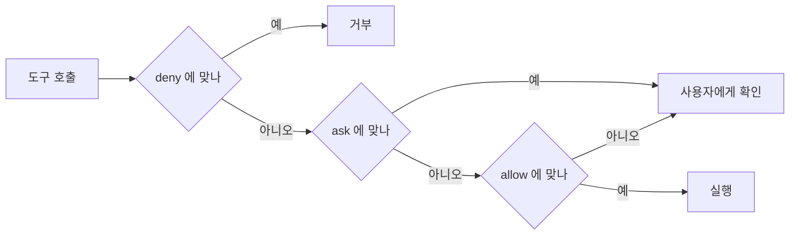
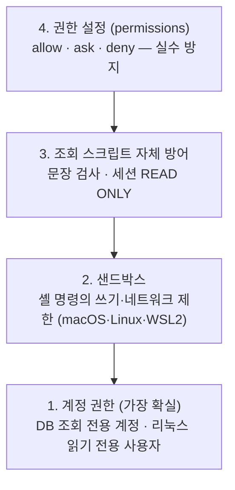

# Claude Code 권한 설정으로 에이전트의 위험한 작업 막기

## 왜 권한 설정이 필요한가

Claude Code 같은 코딩 에이전트는 파일을 읽고 고치고, 셸 명령을 직접 실행합니다.
편리한 만큼 실수의 범위도 넓습니다. DB 접속 정보가 든 파일을 열거나, 조회만 하려다 쓰기 쿼리를 날리거나,
운영 서버에서 파일을 지우는 일이 명령 한 줄로 일어날 수 있습니다.

Claude Code 는 `settings.json` 의 `permissions` 로 도구 사용을 허용·확인·차단할 수 있습니다.
이 글은 그 설정 방법과 함께, **설정만으로는 왜 부족한지**, 그래서 무엇을 더 해야 하는지를 정리합니다.

> 결론부터: 권한 설정은 **실수를 줄이는 장치**이고, 진짜 경계는 **OS·DB 계정 권한**입니다.
> 리눅스 서버나 DB 를 에이전트에게 맡길 때는 **읽기만 가능한 계정을 따로 만들어** 그 계정만 쓰게 하는 것이 좋습니다.

---

## 설정 파일 위치와 우선순위

| 파일 | 적용 범위 |
|---|---|
| `~/.claude/settings.json` | 사용자 — 이 PC 의 모든 프로젝트 |
| `.claude/settings.json` | 공유 프로젝트 — 저장소에 커밋해 팀이 함께 쓴다 |
| `.claude/settings.local.json` | 로컬 프로젝트 — 나만, 이 프로젝트에서만 (커밋하지 않는다) |
| managed settings | 조직 관리자가 배포하는 설정 |

우선순위는 높은 것부터 **managed → 명령행(`--settings`) → 로컬 프로젝트 → 공유 프로젝트 → 사용자** 입니다.
같은 키라면 위쪽이 아래쪽을 덮어씁니다.

단, `permissions.allow` / `deny` 같은 **배열은 덮어쓰지 않고 합쳐집니다.**
사용자 설정의 deny 와 프로젝트 설정의 deny 가 모두 적용된다는 뜻입니다.

그래서 "이 프로젝트에서 무엇이 허용되는가"를 확인하려면 **파일 하나가 아니라 세 파일을 모두** 봐야 합니다.
특히 `settings.local.json` 은 커밋되지 않아 저장소에서는 보이지 않고, 작업 중 "항상 허용"을 누르면 여기에 규칙이 쌓입니다.

---

## allow · ask · deny 와 평가 순서

```json
{
  "permissions": {
    "allow": ["Bash(npm run test *)"],
    "ask":   ["Bash(git push *)"],
    "deny":  ["Bash(rm -rf *)"]
  }
}
```

- `allow` — 묻지 않고 실행
- `ask` — 실행 전에 사용자에게 확인
- `deny` — 실행 거부

평가 순서는 **deny → ask → allow** 이고, 처음 맞는 규칙이 결과를 정합니다.
규칙이 얼마나 구체적인지는 순서를 바꾸지 않습니다.



그래서 **allow 로 deny 에 예외를 뚫을 수 없습니다.**
`Bash(aws *)` 를 deny 에 넣으면 allow 에 `Bash(aws s3 ls)` 가 있어도 막힙니다.
사용자 설정의 deny 는 프로젝트 설정의 allow 도 이깁니다.

---

## 규칙 문법

### Bash / PowerShell

| 규칙 | 의미 |
|---|---|
| `"Bash(npm run test *)"` | `npm run test` 로 시작하는 명령 |
| `"Bash(npm run test:*)"` | 위와 같다 (끝에 붙는 `:*` 는 ` *` 와 동일) |
| `"Bash(*secret*)"` | `*` 는 앞·중간·뒤 어디든 쓸 수 있다 |
| `"PowerShell(Remove-Item *)"` | PowerShell 도 같은 모양 |

- `*` 앞의 공백이 의미가 있습니다. `Bash(ls *)` 는 `lsof` 에 맞지 않고, `Bash(ls*)` 는 맞습니다.
- `&&`, `||`, `;`, `|` 로 이어진 명령은 **쪼개서 각각 검사**합니다. `Bash(safe-cmd *)` 를 허용해도 `safe-cmd && other-cmd` 는 통째로 허용되지 않습니다.
- PowerShell 은 별칭을 정규화합니다. `Get-ChildItem` 규칙은 `ls`, `dir`, `gci` 에도 적용됩니다.

### Read / Edit — 경로 규칙

파일 읽기는 `Read(경로)`, 파일 쓰기(Write·Edit 포함)는 `Edit(경로)` 로 씁니다. 경로는 gitignore 문법입니다.

| 표기 | 의미 |
|---|---|
| `//path` | **절대경로** (파일시스템 루트부터) |
| `~/path` | 홈 디렉토리 기준 |
| `/path` | **설정 파일 기준** 상대경로 — 절대경로가 아니다 |
| `path`, `./path` | 현재 작업 디렉토리 기준 |

- `/path` 를 절대경로로 착각하기 쉽습니다. 프로젝트 설정에서 `/secrets/**` 는 프로젝트 안의 `secrets/` 를 뜻합니다.
- `Read(.env)` 처럼 파일 이름만 쓰면 모든 깊이에서 맞습니다(`**/.env` 와 같음).
- Windows 경로는 POSIX 형태로 바뀝니다. `C:\Users\alice` 는 `/c/Users/alice` 이므로 절대경로 규칙은 `//c/Users/alice/**` 처럼 씁니다.

---

## settings.json 읽는 법

에이전트가 설정 파일을 고쳤거나 팀원이 커밋한 설정을 검토할 때, 사람이 직접 읽고 판단할 수 있어야 합니다.
아래는 흔히 보게 되는 모양의 예시입니다.

```json
{
  "permissions": {
    "allow": [
      "Bash(node tools/db-query.mjs *)",
      "Bash(npm run test *)",
      "Read"
    ],
    "ask": [
      "Bash(git push *)"
    ],
    "deny": [
      "Read(./config/db.env)",
      "Bash(mysql *)"
    ],
    "defaultMode": "default"
  },
  "env": {
    "NODE_ENV": "development"
  },
  "hooks": {
    "PostToolUse": [
      {
        "matcher": "Edit|Write",
        "hooks": [
          { "type": "command", "command": "jq -r '.tool_input.file_path' | { read -r f; npx prettier --write \"$f\"; }", "timeout": 30 }
        ]
      }
    ]
  }
}
```

| 위치 | 읽는 법 |
|---|---|
| `permissions.allow` | **묻지 않고** 실행되는 것. 가장 주의해서 본다 |
| `"Bash(node tools/db-query.mjs *)"` | `node tools/db-query.mjs` 로 시작하는 명령은 인자가 무엇이든 자동 실행 |
| `"Read"` | 괄호 없이 도구 이름만 있으면 **그 도구 전체** 허용 — 모든 파일 읽기를 묻지 않는다 |
| `permissions.ask` | 실행 전에 확인 창이 뜨는 것 |
| `permissions.deny` | 무조건 거부. allow 에 같은 것이 있어도 deny 가 이긴다 |
| `"Read(./config/db.env)"` | 작업 디렉토리의 `config/db.env` 읽기 거부 |
| `defaultMode` | 규칙에 없는 도구를 어떻게 다룰지. `default` 는 처음 쓸 때 묻는다. `acceptEdits` 는 파일 수정을 묻지 않고, `bypassPermissions` 는 거의 모든 확인을 건너뛴다 |
| `env` | 세션에 주입되는 환경변수. **비밀값이 여기 평문으로 들어가 있지 않은지** 본다 |
| `hooks` | 특정 시점에 자동 실행되는 명령. 위 예시는 파일을 고친 뒤(`PostToolUse`) `Edit` 또는 `Write` 도구였으면 prettier 를 돌린다 |
| `hooks.*.matcher` | 어떤 도구에 반응할지. `\|` 로 여러 개 |
| `hooks.*.hooks[].command` | 실제로 실행되는 셸 명령. 도구 입력(고친 파일 경로 등)을 **표준입력 JSON** 으로 받으므로 `jq` 로 꺼낸다. **사람 확인 없이 실행되므로** allow 만큼 주의해서 본다 |

실제 `settings.json` 은 표준 JSON 이라 **주석을 쓸 수 없습니다.** 문법이 깨지면 그 파일의 설정 **전체가 조용히 무시**되므로,
고친 뒤에는 `jq . .claude/settings.json` 처럼 JSON 검사기로 한 번 확인하는 것이 좋습니다.

### 검토 체크리스트

설정 파일을 볼 때 이 순서로 확인합니다.

1. **allow 에 너무 넓은 규칙이 없는가**
   - 도구 이름만 있는 규칙(`"Bash"`, `"Edit"`, `"Read"`)
   - `*` 위치가 앞쪽인 규칙(`"Bash(git *)"` 은 `git push --force` 까지 허용한다 — `*` 는 하위 명령 뒤에 둔다)
   - 임의 코드를 실행할 수 있는 실행기(`"Bash(node *)"`, `"Bash(python *)"`, `"Bash(npx *)"`, `"Bash(sh *)"`)
2. **지키려는 파일·명령이 deny 에 있는가** — 비밀값 파일(`.env`, 키 파일), DB 클라이언트, 삭제·배포 명령
3. **경로 표기가 의도와 맞는가** — 절대경로를 `/` 로 쓰지 않았는가(`//` 여야 한다)
4. **`defaultMode` 가 `bypassPermissions` 로 바뀌어 있지 않은가**
5. **hooks 의 command 가 무엇을 하는가** — 외부로 데이터를 보내거나 파일을 지우는 명령이 없는가
6. **`env` 에 비밀값이 없는가** — 공유 프로젝트 설정은 커밋되어 저장소에 남는다
7. **세 파일을 모두 봤는가** — 사용자·공유 프로젝트·로컬 프로젝트(`settings.local.json`)

지금 세션에 실제로 적용된 규칙은 Claude Code 안에서 `/permissions` 로, 훅은 `/hooks` 로 볼 수 있습니다.
파일을 하나씩 열어 보는 것보다 이쪽이 합쳐진 최종 결과를 보여 줍니다.

---

## 예시: DB 접속 정보를 지키고 조회만 허용하기

DB 조회용 스크립트(`tools/db-query.mjs`)가 접속 정보 파일(`config/db.env`)을 읽어 쿼리를 실행하는 구조라고 하겠습니다.
에이전트는 스크립트로 **조회만** 하고, 접속 정보 파일을 직접 열거나 DB 클라이언트로 붙지 못하게 하고 싶습니다.

```json
{
  "permissions": {
    "allow": [
      "Bash(node tools/db-query.mjs *)"
    ],
    "deny": [
      "Read(./config/db.env)",
      "Edit(./config/db.env)",
      "Bash(mysql *)",
      "Bash(mariadb *)",
      "Bash(mysqldump *)",
      "Bash(psql *)",
      "PowerShell(mysql *)"
    ]
  }
}
```

- `Read` deny 는 Read 도구뿐 아니라 셸의 `cat`, `head`, `tail`, `sed` 처럼 **Claude Code 가 알아보는 파일 명령**과 리다이렉션 대상에도 적용됩니다.
- 조회 스크립트는 node 프로세스가 파일을 직접 읽으므로 이 deny 의 영향을 받지 않고 그대로 동작합니다.

### allow 한 조회 스크립트도 점검한다

`allow` 에 스크립트를 넣는다는 것은 **그 스크립트를 신뢰한다**는 뜻입니다. 묻지 않고 실행되므로,
스크립트가 무엇을 걸러 내는지가 곧 경계가 됩니다. "SELECT 로 시작하는 문장만 받는다" 같은 검사만으로는 부족합니다.
**SELECT 로 시작해도 부작용이 있는 문장**이 있기 때문입니다.

| 문장 | 부작용 |
|---|---|
| `SELECT … INTO OUTFILE '/경로'`, `INTO DUMPFILE` | DB **서버에 파일을 쓴다** (계정에 FILE 권한이 있으면) |
| `SELECT LOAD_FILE('/경로')` | DB 서버의 파일을 읽는다 |
| `SELECT … FOR UPDATE`, `FOR SHARE`, `LOCK IN SHARE MODE` | 행을 잠근다 |
| `SELECT SLEEP(…)`, `BENCHMARK(…)`, `GET_LOCK(…)` | 연결·잠금을 오래 붙잡는다 |
| `SELECT 1 /*! INTO OUTFILE '/경로' */` | MySQL·MariaDB 는 `/*! … */` 주석 **안을 실행한다** — 키워드 검사를 우회하는 대표적인 방법 |

그래서 조회 스크립트는 두 겹으로 막습니다.

1. **문장 검사** — 조회 문장으로 시작하는지, 여러 문장(`;`)이 아닌지, 쓰기·DDL 키워드가 없는지에 더해
   위 표의 패턴을 거부합니다. 주석 우회를 막으려면 블록 주석(`/* */`) 자체를 받지 않는 것이 간단합니다.
2. **세션을 읽기 전용으로 연다** — 접속 직후 한 번 실행해 두면, 검사를 빠져나간 쓰기도 DB 가 거부합니다.

```sql
-- MySQL / MariaDB
SET SESSION TRANSACTION READ ONLY;
-- PostgreSQL
SET SESSION CHARACTERISTICS AS TRANSACTION READ ONLY;
```

```js
// Node + mysql2 예시
const conn = await mysql.createConnection({ ...config, multipleStatements: false }); // 한 번에 한 문장 (기본값도 false)
await conn.query('SET SESSION TRANSACTION READ ONLY');
const [rows] = await conn.query(sql);
```

- 켜졌는지 확인하는 변수 이름이 DB 마다 다릅니다. MySQL 8 은 `@@session.transaction_read_only`,
  MariaDB 10.x 는 `@@session.tx_read_only` 입니다(1 이면 읽기 전용).
- 읽기 전용 트랜잭션에서도 **임시 테이블(TEMPORARY)** 쓰기는 허용됩니다. 실제 테이블을 바꾸는 쓰기만 막습니다.

다만 이 두 겹은 **그 스크립트를 거치는 경로**만 지킵니다. 다음 절에서 보듯, 스크립트를 거치지 않는 접속은 막지 못합니다.

---

## DB 접근 방식 비교: 직접 실행 / CLI 스크립트 / MCP

위 예시는 조회 전용 CLI 스크립트를 `allow` 하는 방식입니다. 에이전트를 DB 에 붙이는 방식은 크게 세 가지입니다.

| 방식 | 모양 | 평가 |
|---|---|---|
| DB 클라이언트 직접 실행 | Bash 로 `mysql -u … -e "…"` | 피한다. 접속 정보가 명령에 드러나고 무엇이든 실행된다 |
| 조회 전용 CLI 스크립트 | 스크립트 + `Bash(node tools/db-query.mjs *)` allow | 가볍고 내부를 직접 통제할 수 있다 |
| DB MCP 서버 | 에이전트에 `query`·`list_tables` 같은 **도구**로 붙는다 | 요즘 많이 쓰는 방식 |

### MCP 의 장점

**도구 단위로 권한을 겁니다.** 규칙 이름이 명령 문자열이 아니라 도구 이름이라 Bash 패턴보다 명확합니다.

| 규칙 | 의미 |
|---|---|
| `"mcp__mydb"` | `mydb` 서버의 모든 도구 |
| `"mcp__mydb__list_tables"` | `list_tables` 도구 하나 |
| `"mcp__mydb__*"` | `mydb` 서버의 모든 도구(와일드카드) |

예를 들어 스키마 조회 도구는 `allow`, SQL 실행 도구는 `ask` 로 두면 쿼리마다 확인받을 수 있습니다.
allow 의 와일드카드는 `mcp__서버__` 뒤에서만 동작합니다(`"mcp__*"` 는 allow 에서 무시되고, deny·ask 에서는 모든 MCP 도구에 걸립니다).

그 밖에:

- **접속 정보를 에이전트 작업 공간에서 떼어 낼 수 있다.** MCP 서버 프로세스가 환경변수로 들고 있고, 에이전트는 도구만 호출합니다.
- **스키마 탐색 도구**가 있어 에이전트가 테이블 구조를 덜 헤맵니다.
- 같은 설정을 다른 MCP 클라이언트에서도 쓰고, 팀에 `.mcp.json` 으로 공유하기 쉽습니다.

### MCP 여도 남는 것

- **MCP 서버의 "읽기 전용 모드"도 프로그램 안의 검사**입니다. 위에서 본 조회 스크립트의 자체 방어와 같은 층입니다.
  실제로 MCP 레퍼런스 Postgres 서버는 쿼리를 읽기 전용 트랜잭션으로 감쌌지만 **문장이 하나인지 검사하지 않아서**,
  `COMMIT; DROP SCHEMA public CASCADE;` 처럼 트랜잭션을 먼저 끝내 버리면 뒤 문장이 계정 권한 그대로 실행되는 취약점이 보고됐습니다
  ([Datadog Security Labs](https://securitylabs.datadoghq.com/articles/mcp-vulnerability-case-study-SQL-injection-in-the-postgresql-mcp-server/)).
  앞에서 "여러 문장(`;`)을 거부"하고 "한 번에 한 문장만 실행"하도록 한 이유가 이것입니다.
- **MCP 서버는 Claude Code 샌드박스 밖에서 실행됩니다.** 샌드박스로 막을 수 없습니다.
- 외부 MCP 서버는 **서드파티 코드**입니다. 설치 전에 출처와 유지보수 상태를 확인합니다.

→ 어떤 방식을 고르든 **DB 계정은 조회 전용**이어야 합니다. 방식은 편의와 통제 수준의 차이이고, 경계는 계정 권한입니다.

---

## 한계 — 권한 설정은 보안 경계가 아니다

공식 문서도 Bash 규칙은 **프로그램을 둘러싼 보안 경계가 아니라고** 명시합니다. 규칙은 명령 **문자열**을 볼 뿐입니다.

- `Bash(curl *)` 를 막아도 `/usr/bin/curl …` 이나 `sh -c 'curl …'` 은 통과합니다.
- `Bash(git push *)` 를 막아도 `git -C . push origin main` 은 통과합니다.
- `Read` deny 는 파일 이름을 적지 않고 읽는 명령(그 디렉토리에서 `grep -r pattern .`)이나,
  **파일을 스스로 여는 Python·Node 스크립트**는 막지 못합니다.

위 예시도 마찬가지입니다. 에이전트가 새 스크립트를 써서 DB 드라이버로 직접 접속하면 설정으로는 막을 수 없습니다.
DB 계정에 쓰기 권한이 있다면 그 스크립트는 쓰기도 할 수 있습니다.

OS 수준에서 막는 **샌드박스**(`sandbox` 설정)도 있습니다. 셸 명령의 파일 쓰기·네트워크를 제한하지만,
macOS·Linux·WSL2 에서만 동작하고 **Windows 네이티브에서는 동작하지 않습니다.**
또 Claude 의 파일 도구, MCP 서버, 훅은 샌드박스 밖에서 돕니다.

---

## 그래서: 리눅스·DB 는 읽기 전용 계정을 따로 만든다

권한 설정과 샌드박스만으로는 부족합니다. **리눅스 서버나 DB 에 에이전트를 붙일 때는 읽기만 가능한 계정을 따로 만들고,
에이전트에게는 그 계정만 주는 것이 좋습니다.** 계정에 쓰기 권한이 없으면, 에이전트가 어떤 명령이나 스크립트를 쓰든
OS 와 DB 가 쓰기를 거부합니다. 실수든 잘못된 판단이든 결과가 같습니다.

### DB — 조회 전용 계정

MySQL / MariaDB:

```sql
CREATE USER 'app_ro'@'10.0.0.%' IDENTIFIED BY '<비밀번호>';
GRANT SELECT, SHOW VIEW ON mydb.* TO 'app_ro'@'10.0.0.%';

-- 확인: SELECT, SHOW VIEW 만 있어야 한다
SHOW GRANTS FOR 'app_ro'@'10.0.0.%';
```

PostgreSQL:

```sql
CREATE ROLE app_ro LOGIN PASSWORD '<비밀번호>';
GRANT CONNECT ON DATABASE mydb TO app_ro;
GRANT USAGE ON SCHEMA public TO app_ro;
GRANT SELECT ON ALL TABLES IN SCHEMA public TO app_ro;
ALTER DEFAULT PRIVILEGES IN SCHEMA public GRANT SELECT ON TABLES TO app_ro;  -- 앞으로 만들 테이블도
ALTER ROLE app_ro SET default_transaction_read_only = on;                    -- 트랜잭션도 읽기 전용
```

- 접속 위치(`'10.0.0.%'`)는 에이전트가 도는 PC 대역으로 좁힙니다. `'%'` 는 어디서든 접속을 허용합니다.
- 기존에 쓰던 계정이 `GRANT ALL PRIVILEGES ON *.*` 같은 관리자급인지 `SHOW GRANTS` 로 먼저 확인해 보세요.
  개발 편의로 만든 공용 계정이 이런 경우가 흔합니다.
- 에이전트용 접속 정보 파일에는 **이 조회 계정만** 넣고, 쓰기 계정 정보는 에이전트 환경에 두지 않습니다.

### 리눅스 — 읽기 전용 사용자

```bash
# 1) 전용 사용자 생성 — sudo·wheel·docker 그룹에 넣지 않는다 (docker 그룹은 사실상 root)
sudo useradd -m -s /bin/bash agent_ro

# 2) 봐야 할 디렉토리에만 읽기 권한 (X: 디렉토리만 진입 권한)
sudo setfacl -R -m u:agent_ro:rX /srv/app
sudo setfacl -R -d -m u:agent_ro:rX /srv/app   # 새로 생기는 파일에도 적용

# 3) 확인
id agent_ro                 # 소속 그룹
sudo -l -U agent_ro         # sudo 권한이 없어야 한다
```

- 에이전트가 SSH 로 서버를 볼 때는 이 사용자의 키로만 접속하게 합니다.
- 로그·설정을 보는 용도라면 `/srv/app` 처럼 필요한 경로만 열고, 비밀값이 든 파일(`.env`, 키 파일)은 열지 않습니다.

---

## 정리 — 방어는 층으로



| 층 | 막는 것 | 못 막는 것 |
|---|---|---|
| 권한 설정 | 알려진 명령·파일 접근 실수 | 우회 경로(다른 바이너리, 스크립트) |
| 스크립트 검사 + 세션 READ ONLY | allow 한 스크립트를 통한 쓰기·부작용 | 그 스크립트를 거치지 않는 접속 |
| 샌드박스 | 셸 명령의 파일 쓰기·네트워크 | 파일 도구·MCP, Windows 네이티브 |
| 계정 권한 | **어떤 경로로 오든** 쓰기 | — |

권한 설정은 빠르게 걸 수 있는 첫 번째 안전장치이고, 계정 권한은 마지막 방어선입니다.
한 층만으로는 빈틈이 남으니 여러 층을 함께 거는 것이 좋습니다.

## 참고

- [Configure permissions — Claude Code Docs](https://code.claude.com/docs/en/permissions)
- [Settings — Claude Code Docs](https://code.claude.com/docs/en/settings)
- [Sandboxing — Claude Code Docs](https://code.claude.com/docs/en/sandboxing)
