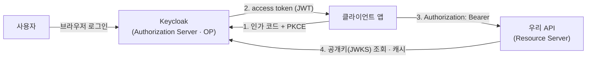
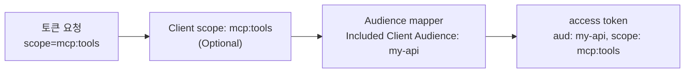

# Keycloak — OAuth 2.0 · OIDC 를 구현한 인가 서버 다루기

## Keycloak 은 무엇인가

Keycloak 은 **로그인과 토큰 발급을 전담하는 오픈소스 서버**입니다. 표준으로 말하면 다음 셋을 한 번에 맡습니다.

| 표준 | Keycloak 의 역할 |
|---|---|
| [OAuth 2.0](https://github.com/eastshine-high/til/blob/main/oauth/oauth-2.0.md) / [2.1](https://github.com/eastshine-high/til/blob/main/oauth/oauth-2.1.md) | Authorization Server — access token 발급 |
| [OpenID Connect](https://github.com/eastshine-high/til/blob/main/oauth/oidc.md) | OpenID Provider — ID Token 발급, 로그인(SSO) |
| SAML 2.0 | Identity Provider — 오래된 기업 시스템 연동 |

로그인 화면, 사용자 저장소, SSO 세션, 다단계 인증, LDAP·AD 연동, 외부 IdP(구글 등) 연동을 한곳에서 처리합니다.
앱은 비밀번호를 직접 다루지 않고, Keycloak 이 발급한 토큰만 검증합니다.



핵심은 4번입니다. API 서버는 요청마다 Keycloak 에 묻지 않고, **공개키만 받아 두고 JWT 서명을 스스로 검증**합니다.

> 이 글은 Keycloak 26.x(2026년 11월 기준 최신 26.8.2) 기준입니다.

---

## 핵심 용어

| 용어 | 뜻 | 기억할 점 |
|---|---|---|
| **Realm** | 사용자 · 클라이언트 · 역할을 관리하는 격리 공간. 사실상 **테넌트** | `master` realm 은 Keycloak 관리 전용. 업무용 realm 을 따로 만든다. realm 마다 `iss` 가 다르다 |
| **Client** | Keycloak 에 로그인·토큰을 요청하는 앱. OAuth 의 Client | 토큰을 **받는** API(리소스 서버)도 audience 대상으로 client 로 등록하는 경우가 많다 |
| Public / Confidential | `Client authentication` OFF / ON | SPA·모바일·CLI 는 public → PKCE 필수 |
| **Client scope** | 프로토콜 매퍼와 역할 범위를 묶은 재사용 설정 | 요청 `scope` 에 따라 토큰에 클레임·**audience** 를 넣는 장치 |
| Default / Optional scope | 항상 붙는 scope / 클라이언트가 요청할 때만 붙는 scope | API 권한용 scope 는 보통 Optional |
| **Protocol mapper** | 토큰에 어떤 클레임을 넣을지 정하는 규칙 | **Audience mapper** 가 `aud` 를 넣는다 |
| **User / Group** | 로그인 주체 / 사용자 묶음 | 그룹의 역할·속성을 멤버가 상속 |
| **Role** | 권한 묶음. realm role 과 client role | 토큰의 `realm_access.roles`, `resource_access.{client}.roles` |
| Session | 로그인 시 생기는 SSO 세션 | 토큰 수명·세션 수명은 realm 설정 |
| Identity brokering | 로그인 자체를 외부 IdP(OIDC·SAML·소셜)에 위임 | "Google 로 로그인"을 Keycloak 앞에 붙이기 |
| User federation | LDAP·AD 의 사용자로 인증 | 사내 계정 연동 |
| Service account | client 자신이 주체가 되는 계정 | client credentials grant 용 |

---

## 엔드포인트

모든 엔드포인트는 `/realms/{realm}` 아래에 있습니다. 하나만 기억한다면 **Discovery** 입니다. 나머지 주소를 모두 알려 줍니다.

| 이름 | 경로 | 용도 |
|---|---|---|
| **Discovery** | `/.well-known/openid-configuration` | 엔드포인트 · 지원 기능 · `jwks_uri` 를 담은 JSON |
| Authorization | `/protocol/openid-connect/auth` | 브라우저 로그인 시작 |
| Token | `/protocol/openid-connect/token` | 코드 → 토큰, refresh, client credentials, token exchange |
| **Certs (JWKS)** | `/protocol/openid-connect/certs` | 서명 검증용 공개키. API 서버가 캐시해서 쓴다 |
| UserInfo | `/protocol/openid-connect/userinfo` | access token 으로 사용자 정보 조회 |
| Introspection | `/protocol/openid-connect/token/introspect` | 토큰 유효성을 Keycloak 에 묻기 (confidential client 만) |
| Revocation | `/protocol/openid-connect/revoke` | 토큰 폐기 |
| Logout | `/protocol/openid-connect/logout` | RP-Initiated Logout |
| Device | `/protocol/openid-connect/auth/device` | 입력이 불편한 기기용 |
| Client Registration | `/clients-registrations/openid-connect` | Dynamic Client Registration (RFC 7591) |

issuer 는 `https://{keycloak-host}/realms/{realm}` 형태입니다. 경로가 붙어 있다는 점이 MCP 클라이언트의 메타데이터 탐색 순서에 영향을 줍니다([MCP 인가](https://github.com/eastshine-high/til/blob/main/oauth/mcp-authorization.md) 참고).

---

## 클라이언트 설정

관리 콘솔의 client 설정 스위치가 OAuth grant 와 그대로 대응합니다.

| 설정 | 켜면 | 대응하는 grant |
|---|---|---|
| `Client authentication` | confidential client (secret 등으로 인증) | — |
| `Standard flow` | 인가 코드 흐름 허용 | Authorization Code |
| `Direct access grants` | 사용자 ID·비밀번호를 직접 받는 방식 허용 | Password (**끈다**) |
| `Implicit flow` | 인가 응답에 토큰 직접 발급 | Implicit (**끈다**) |
| `Service accounts roles` | 클라이언트 자신의 토큰 발급 | Client Credentials |
| `OAuth 2.0 Device Authorization Grant` | 기기 코드 흐름 | Device Code |
| `Standard Token Exchange` | 받은 토큰을 다른 대상용으로 교환 | Token Exchange (RFC 8693) |

그 밖에 챙길 설정:

- **Valid redirect URIs**: 정확한 값으로 등록합니다. `*` 와일드카드는 개발 때만.
- **Web origins**: 브라우저 앱의 CORS 허용 출처. `+` 는 redirect URI 의 출처를 그대로 쓴다는 뜻입니다.
- **PKCE**: Advanced 탭의 `Proof Key for Code Exchange Code Challenge Method` 를 `S256` 으로 두면 이 client 에 PKCE 를 강제합니다.

OAuth 2.1 기준으로 정리하면 **Standard flow + PKCE(S256)** 만 켜고, Implicit 과 Direct access grants 는 끄는 것이 기본입니다.

---

## 토큰

| 토큰 | 누가 읽나 | 기본 수명 (realm 설정) |
|---|---|---|
| **Access token** | 리소스 서버(API) | 5분 (`Access Token Lifespan`) |
| ID token | 클라이언트 | access token 과 같음 |
| Refresh token | 클라이언트 → Keycloak | SSO 세션에 묶임 (`SSO Session Idle` 30분, `SSO Session Max` 10시간) |

Keycloak 의 access token 은 **서명된 JWT** 입니다.

```json
{
  "exp": 1764000300,
  "iat": 1764000000,
  "iss": "https://kc.example.com/realms/myrealm",
  "aud": ["my-api", "account"],
  "sub": "f1c2a3b4-...",
  "typ": "Bearer",
  "azp": "my-web-app",
  "sid": "8b0e...",
  "scope": "openid profile email mcp:tools",
  "preferred_username": "jane",
  "realm_access": { "roles": ["user"] },
  "resource_access": { "my-api": { "roles": ["reader"] } }
}
```

| 클레임 | 의미 | 검증 포인트 |
|---|---|---|
| `iss` | 발급자 `{base}/realms/{realm}` | 설정한 issuer 와 **정확히** 일치 |
| `aud` | 이 토큰을 받을 대상 (문자열 또는 배열) | **내 API 식별자가 있어야 한다** |
| `azp` | 토큰을 받아 간 client ID | 허용한 클라이언트만 받으려면 화이트리스트 |
| `scope` | 공백 구분 scope 목록 | 필요한 scope 가 없으면 403 |
| `exp` / `iat` / `nbf` | 만료 / 발급 / 유효 시작 | 작은 시계 오차만 허용 |
| `sub` | 사용자 고유 ID (UUID) | 변하지 않는 키 |
| `preferred_username` | 로그인 ID | 사람이 읽는 값. 바뀔 수 있다 |
| `typ` | Keycloak 고유. access token 은 `Bearer`, ID token 은 `ID` | ID token 을 access token 으로 쓰는 실수 막기 |
| `realm_access`, `resource_access` | realm 역할 / client 별 역할 | Keycloak 고유 클레임. 역할 기반 권한 |

> `aud` 에 자주 보이는 `account` 는 Keycloak 의 계정 관리 콘솔용 client 입니다. 기본 역할 매핑 때문에 들어가며, 우리 API 와는 관계가 없습니다.

---

## Audience 를 토큰에 넣기

리소스 서버는 **`aud` 에 자기 자신이 있는 토큰만** 받아야 합니다(audience 검증). 그런데 Keycloak 은 기본적으로 우리 API 를 `aud` 에 넣어 주지 않습니다. 직접 설정해야 합니다.

### 방법 1. Client scope + Audience mapper (기본)



1. **Client scopes** → `mcp:tools` 같은 scope 생성 (`Include in token scope` ON)
2. 그 scope 의 **Mappers** → `Audience` 매퍼 추가
   - `Included Client Audience`: 리소스 서버로 등록한 client (`my-api`) 선택, 또는
   - `Included Custom Audience`: 임의 문자열 (예: MCP 서버 URL `https://mcp.example.com/mcp`)
   - `Add to access token` ON
3. 호출할 client 의 **Client scopes** 탭에서 이 scope 를 **Optional** 로 할당

이제 클라이언트가 `scope=mcp:tools` 를 요청하면 토큰에 `aud` 와 `scope` 가 함께 들어갑니다. **"권한(scope)을 요청하면 대상(aud)도 정해진다"** 는 구조입니다.

### 방법 2. Resource Indicators (RFC 8707, 실험 기능)

OAuth 표준 방식은 클라이언트가 `resource=https://mcp.example.com/mcp` 를 보내면 그 값이 `aud` 가 되는 것입니다. Keycloak 에서는 실험 기능이라 `--features=resource-indicators` 로 켜야 합니다. 이 기능이 꺼져 있으면 Keycloak 은 `resource` 파라미터를 인식하지 않으므로, 방법 1처럼 scope 로 audience 를 정합니다.

---

## Grant type 지원

| Grant | Keycloak | 비고 |
|---|---|---|
| **Authorization Code + PKCE** | 지원 | 사용자 로그인의 표준 |
| **Client Credentials** | 지원 | `Service accounts roles` ON |
| Refresh Token | 지원 | |
| Token Exchange (RFC 8693) | 지원 | Standard token exchange (V2). client 에서 스위치를 켜야 함 |
| Device Authorization (RFC 8628) | 지원 | |
| CIBA | 지원 | 백채널 인증 |
| JWT Authorization Grant (RFC 7523) | 지원 | 외부 JWT 를 토큰으로 교환 |
| Implicit | 지원하지만 **쓰지 않는다** | OAuth 2.1 에서 삭제 |
| Password (Direct access grants) | 지원하지만 **쓰지 않는다** | 테스트 외 사용 금지 |

---

## 리소스 서버에서 토큰 검증하기

| 방식 | 방법 | 장단점 |
|---|---|---|
| **로컬 검증 (권장)** | JWKS 공개키를 캐시하고 JWT 서명을 직접 검증 | 빠르고 Keycloak 부하가 없다. 대신 만료 전 폐기는 바로 반영되지 않는다 → access token 수명을 짧게 |
| Introspection | 요청마다 introspect 엔드포인트 호출 | 폐기가 즉시 반영되지만 느리고 Keycloak 에 부하 |

로컬 검증 체크리스트:

1. `Authorization: Bearer <token>` 헤더에서만 꺼낸다 (쿼리 스트링 토큰은 무시)
2. 서명 알고리즘을 고정한다 (예: `RS256`). `alg: none` 거부
3. 헤더의 `kid` 로 JWKS 키를 고른다. 모르는 `kid` 면 JWKS 를 한 번 새로 받는다 (키 교체 대응)
4. `iss` 일치, `exp` / `nbf` 확인
5. **`aud` 에 내 API 식별자 포함**
6. (선택) `azp` 허용 목록
7. 필요한 `scope` 확인 → 없으면 **403 `insufficient_scope`**
8. `typ` 이 `Bearer` 인지 (ID token 거부)
9. `sub` 또는 `preferred_username` 으로 내부 사용자 매핑

Spring Security 라면 issuer 만 설정해도 Discovery → JWKS → 서명·`iss`·`exp` 검증까지 해 줍니다. **`aud` 와 scope 검증은 직접 추가**해야 하는 경우가 많으니 빠뜨리지 않아야 합니다.

```yaml
spring:
  security:
    oauth2:
      resourceserver:
        jwt:
          issuer-uri: https://kc.example.com/realms/myrealm
          audiences: my-api
```

---

## MCP 인가 서버로 쓰기

[MCP 인가 스펙](https://github.com/eastshine-high/til/blob/main/oauth/mcp-authorization.md)에서 Keycloak 은 **인가 서버** 자리에 들어갑니다. MCP 서버는 리소스 서버로서 PRM(`/.well-known/oauth-protected-resource`)의 `authorization_servers` 에 realm issuer 를 적습니다.

| MCP 가 요구하는 것 | Keycloak |
|---|---|
| OAuth 2.1 (인가 코드 + PKCE) | 지원 |
| 인가 서버 메타데이터 (RFC 8414 / OIDC Discovery) | 지원 |
| 인가 응답의 `iss` (RFC 9207) | 지원 |
| Resource Indicators (RFC 8707) | **실험 기능** (`--features=resource-indicators`). 꺼져 있으면 scope + audience mapper 로 대체 |
| Client ID Metadata Document (CIMD) | **실험 기능** (`--features=cimd`) |
| Dynamic Client Registration (RFC 7591) | 지원 (MCP 에서는 deprecated) |

그래서 RFC 8707 을 켜지 않은 Keycloak 은 최신 MCP 스펙(2025-06-18 이후)을 **"resource indicator 없이 부분 지원"** 하는 상태입니다. 실무에서는 다음처럼 맞춥니다.

1. MCP 용 client scope (`mcp:tools` 등, Optional) + Audience mapper 로 `aud` 에 MCP 서버 URL 넣기
2. MCP 서버 PRM 의 `scopes_supported` 에 그 scope 를 적어, 클라이언트가 요청하게 하기
3. 클라이언트 등록 방식 정하기
   - **사전 등록**: 관리자가 client 를 만들어 ID 배포. 가장 단순
   - **CIMD**: client policy(`client-id-uri` 조건) + client profile(신뢰 도메인 등)을 만들어 허용할 클라이언트를 제한
   - **DCR**: MCP Inspector 처럼 DCR 만 쓰는 도구용. 익명 등록 정책(Trusted Hosts, 허용 scope 등)을 좁게 설정
4. MCP 서버가 다른 API 를 호출해야 하면 **Token Exchange** 로 그 API 용 토큰을 새로 받기 (토큰 전달 금지)

> 실험 기능은 이후 버전에서 동작이 바뀔 수 있습니다. 운영에 쓰기 전에 사용하는 Keycloak 버전의 MCP 가이드를 확인합니다.

---

## 로컬 실습

```bash
docker run -p 127.0.0.1:8080:8080 \
  -e KC_BOOTSTRAP_ADMIN_USERNAME=admin \
  -e KC_BOOTSTRAP_ADMIN_PASSWORD=admin \
  quay.io/keycloak/keycloak:26.8.2 start-dev
```

1. `http://localhost:8080/admin` 로그인 (admin/admin 은 개발용)
2. realm `myrealm` 생성 → user 생성 → Account Console(`/realms/myrealm/account`)로 로그인 확인
3. Discovery 열어 보기: `http://localhost:8080/realms/myrealm/.well-known/openid-configuration`
4. client 두 개 만들기
   - `my-api`: 리소스 서버 (audience 대상). 로그인에 쓰지 않으니 flow 는 모두 꺼도 된다
   - `my-caller`: 호출자. 실습용으로 `Client authentication` ON + `Service accounts roles` ON
5. client scope `mcp:tools`(Optional) 생성 → Audience mapper 로 `my-api` 추가 → `my-caller` 에 할당
6. 토큰을 받아 디코드

```bash
curl -s -X POST http://localhost:8080/realms/myrealm/protocol/openid-connect/token \
  -d grant_type=client_credentials \
  -d client_id=my-caller \
  -d client_secret=<secret> \
  -d scope=mcp:tools
```

access token 에서 `iss`, `aud`(= `my-api`), `azp`(= `my-caller`), `scope` 를 확인합니다.
`scope=mcp:tools` 를 빼고 다시 받으면 `aud` 에서 `my-api` 가 사라집니다. 이것이 Optional client scope 와 Audience mapper 의 동작입니다.

> 운영 토큰은 jwt.io 같은 외부 사이트에 붙여 넣지 않습니다. 로컬에서 `cut -d. -f2 | base64 -d` 등으로 열어 봅니다.

---

## 정리

- Keycloak 은 OAuth 2.0 인가 서버 + OIDC Provider. **realm = 테넌트**, issuer 는 `/realms/{realm}`.
- client 설정은 grant 와 대응한다. **Standard flow + PKCE(S256)** 만 켜고 Implicit·Direct access grants 는 끈다.
- `aud` 는 자동으로 들어가지 않는다. **client scope + Audience mapper** 로 넣는다.
- 리소스 서버는 JWKS 로 **로컬 검증**하고, `iss` · `exp` · **`aud`** · `scope` 를 확인한다.
- MCP 인가 서버로는 쓸 수 있지만 RFC 8707·CIMD 는 실험 기능이다.

## 참고

- [Keycloak Documentation](https://www.keycloak.org/documentation)
- [Getting started — Docker](https://www.keycloak.org/getting-started/getting-started-docker)
- [Server Administration Guide](https://www.keycloak.org/docs/latest/server_admin/index.html) — Core concepts and terms, Client scopes, Audience support 절
- [Securing applications — OIDC layers](https://www.keycloak.org/securing-apps/oidc-layers)
- [Integrating with Model Context Protocol (MCP)](https://www.keycloak.org/securing-apps/mcp-authz-server)
- [Token exchange](https://www.keycloak.org/securing-apps/token-exchange)
