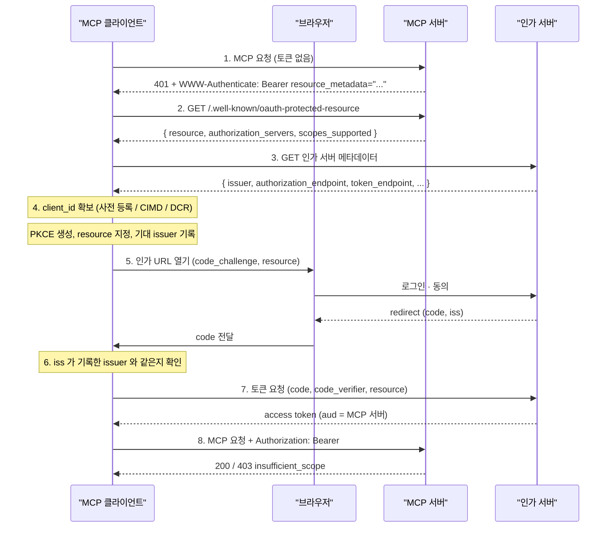
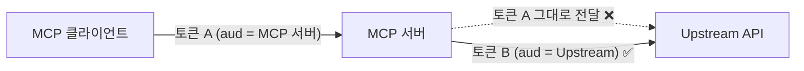

# MCP 인가(Authorization) — MCP 서버를 OAuth 로 보호하기

## MCP 인가가 다루는 것

MCP(Model Context Protocol) 서버를 HTTP 로 공개하면, "누가 이 도구를 호출하는가"를 확인해야 합니다.
MCP 스펙의 Authorization 절은 이 문제를 **OAuth 2.1 위에서** 풉니다. 새 인증 방식을 만들지 않고, 기존 OAuth 표준 몇 개를 골라 조합합니다.

> 이 글은 MCP 스펙 `2026-07-28` 판 기준입니다. OAuth 2.1 자체는 [OAuth 2.1 핵심 정리](https://github.com/eastshine-high/til/blob/main/oauth/oauth-2.1.md)를 먼저 보면 좋습니다.

인가는 **선택 사항**이고, 전송 방식에 따라 적용 여부가 다릅니다.

| 전송 방식                     | 인가                                              |
| ------------------------- | ----------------------------------------------- |
| Streamable HTTP 등 HTTP 기반 | 이 스펙을 따르는 것을 권장 (SHOULD)                        |
| STDIO (로컬 프로세스)           | 이 스펙을 따르지 않는다 (SHOULD NOT). 환경 변수 등에서 자격증명을 읽는다 |
| 그 밖의 전송                   | 해당 프로토콜의 보안 모범 사례를 따른다                          |

---

## 역할 — OAuth 의 역할에 그대로 대응

| OAuth 역할             | MCP 에서                                                       | 하는 일                       |
| -------------------- | ------------------------------------------------------------ | -------------------------- |
| Resource Server      | **MCP 서버**                                                   | 토큰을 검증하고 도구·리소스를 제공        |
| Client               | **MCP 클라이언트** (Claude Code, Claude Desktop, MCP Inspector 등) | 사용자를 대신해 토큰을 받아 MCP 서버를 호출 |
| Authorization Server | **인가 서버** (Keycloak, Auth0, Entra ID 등)                      | 사용자를 로그인시키고 토큰을 발급         |

인가 서버를 어떻게 구현하는지는 스펙 범위 밖입니다. MCP 서버와 같은 곳에 둘 수도 있고 별도 서버(예: Keycloak)를 쓸 수도 있습니다.

### 쓰는 표준

| 표준                                       | MCP 에서 쓰는 곳                                    |
| ---------------------------------------- | ---------------------------------------------- |
| OAuth 2.1                                | 전체 뼈대. 인가 코드 + PKCE                            |
| RFC 6750 Bearer Token Usage              | `Authorization: Bearer`, `WWW-Authenticate` 오류 |
| **RFC 9728 Protected Resource Metadata** | MCP 서버가 "내 인가 서버는 여기"라고 알림                     |
| RFC 8414 / OIDC Discovery                | 인가 서버의 엔드포인트 찾기                                |
| **RFC 8707 Resource Indicators**         | 토큰을 특정 MCP 서버용으로 받기 (`resource` → `aud`)       |
| RFC 9207 Issuer Identification           | 인가 응답의 `iss` 검증 (mix-up 방지)                    |
| Client ID Metadata Document (CIMD)       | 사전 등록 없이 클라이언트 식별                              |
| RFC 7591 Dynamic Client Registration     | 클라이언트 자동 등록 (하위 호환용, deprecated)               |

---

## 전체 흐름

MCP 클라이언트는 처음에 인가 서버가 어디 있는지 모릅니다. **401 응답에서 출발해 하나씩 찾아갑니다.**



아래에서 단계별로 봅니다.

---

## 1~2. 인가 서버 위치 알리기 — Protected Resource Metadata (RFC 9728)

MCP 서버는 **Protected Resource Metadata(PRM)** 를 반드시 제공해야 합니다(MUST). PRM 은 "이 리소스는 어떤 인가 서버의 토큰을 받는가"를 적은 JSON 입니다.

```json
{
  "resource": "https://mcp.example.com/mcp",
  "authorization_servers": ["https://auth.example.com/realms/myrealm"],
  "scopes_supported": ["mcp:tools"],
  "bearer_methods_supported": ["header"]
}
```

- `authorization_servers` 에는 인가 서버가 **최소 하나** 있어야 합니다.
- 여러 개면 어느 것을 쓸지는 클라이언트가 고릅니다. 인가 서버마다 client ID·토큰을 따로 관리해야 합니다.

클라이언트가 PRM 을 찾는 방법은 두 가지이고, MCP 서버는 그중 하나 이상을 구현합니다.

| 방법 | 예 |
|---|---|
| 401 응답 헤더의 `resource_metadata` | `WWW-Authenticate: Bearer resource_metadata="https://mcp.example.com/.well-known/oauth-protected-resource/mcp"` |
| well-known 경로 | MCP 엔드포인트 경로를 붙인 `/.well-known/oauth-protected-resource/mcp` → 없으면 루트 `/.well-known/oauth-protected-resource` |

클라이언트는 헤더에 `resource_metadata` 가 있으면 그것을 쓰고, 없으면 위 순서로 well-known 경로를 시도합니다.

---

## 3. 인가 서버 메타데이터 찾기 (RFC 8414 / OIDC Discovery)

인가 서버는 RFC 8414 메타데이터나 OIDC Discovery 중 하나 이상을 제공하고, 클라이언트는 둘 다 지원해야 합니다.

issuer 에 경로가 있으면(예: Keycloak 의 `https://auth.example.com/realms/myrealm`) 클라이언트는 다음 순서로 시도합니다.

| 순서 | URL |
|---|---|
| 1 | `https://auth.example.com/.well-known/oauth-authorization-server/realms/myrealm` |
| 2 | `https://auth.example.com/.well-known/openid-configuration/realms/myrealm` |
| 3 | `https://auth.example.com/realms/myrealm/.well-known/openid-configuration` |

issuer 에 경로가 없으면 `/.well-known/oauth-authorization-server` → `/.well-known/openid-configuration` 순서입니다.

> 메타데이터의 `issuer` 값은 URL 을 만들 때 쓴 issuer 와 **정확히 같아야** 합니다. 다르면 그 메타데이터를 쓰면 안 됩니다.
> 공격자 서버가 "나는 정상 인가 서버다"라고 주장하는 문서를 돌려주는 것을 막기 위해서입니다.

또 클라이언트는 메타데이터에 **`code_challenge_methods_supported` 가 없으면 진행하지 않습니다**(PKCE 지원을 확인할 방법이 그것뿐이기 때문). OIDC Discovery 를 제공하는 인가 서버도 이 필드를 넣어야 합니다.

---

## 4. 클라이언트 등록 — client_id 를 어떻게 얻나

일반 웹 서비스와 달리 MCP 는 **처음 보는 클라이언트가 처음 보는 서버에 붙는** 경우가 많습니다. 그래서 등록 방식이 세 가지입니다.

| 방식 | 언제 | 상태 |
|---|---|---|
| **사전 등록 (Pre-registration)** | 클라이언트와 서버가 이미 아는 사이. 관리자가 client 를 만들어 ID 를 배포 | 허용 |
| **CIMD (Client ID Metadata Document)** | 서로 처음 보는 사이 (가장 흔한 경우) | 권장 (SHOULD) |
| **DCR (Dynamic Client Registration, RFC 7591)** | 클라이언트가 `POST /register` 로 스스로 등록 | **deprecated**, 하위 호환용 |

클라이언트는 **사전 등록 → CIMD → DCR → 사용자에게 직접 입력받기** 순서로 시도합니다.

### CIMD 동작

CIMD 에서는 **client_id 자체가 HTTPS URL** 입니다. 인가 서버는 그 URL 의 JSON 을 읽어 클라이언트 정보를 얻습니다.

```json
{
  "client_id": "https://app.example.com/oauth/client-metadata.json",
  "client_name": "Example MCP Client",
  "redirect_uris": ["http://127.0.0.1:3000/callback"],
  "grant_types": ["authorization_code"],
  "response_types": ["code"],
  "token_endpoint_auth_method": "none"
}
```

| 주체 | 규칙 |
|---|---|
| 클라이언트 | `client_id` URL 은 https 이고 경로가 있어야 한다. 문서 안의 `client_id` 는 URL 과 정확히 같아야 한다 |
| 인가 서버 | 문서를 가져와 `client_id` 일치, 필수 필드, redirect URI 를 검증한다. HTTP 캐시 헤더대로 캐시한다 |
| 인가 서버 | 메타데이터에 `client_id_metadata_document_supported: true` 로 지원을 알린다 |

CIMD 는 등록 절차가 없어서 편하지만 위험도 있습니다.

- 인가 서버가 임의 URL 을 가져오므로 **SSRF** 를 고려해야 합니다.
- CIMD 만으로는 `localhost` redirect 를 쓰는 **다른 앱의 사칭**을 막지 못합니다. 인가 서버는 동의 화면에 redirect URI 호스트를 분명히 보여 주고, localhost 전용 클라이언트에는 경고를 띄우는 것이 좋습니다.
- 그래서 인가 서버는 **신뢰 도메인 정책**(허용할 client_id 도메인 목록)을 둘 수 있습니다.

---

## 5~7. 인가 코드 + PKCE + resource

여기는 OAuth 2.1 인가 코드 흐름 그대로이고, MCP 가 몇 가지를 덧붙입니다.

### PKCE

- 클라이언트는 PKCE 를 반드시 쓰고, 가능하면 `S256` 을 씁니다.
- 인가 서버 메타데이터에서 PKCE 지원을 확인한 뒤에만 진행합니다.

### resource 파라미터 (RFC 8707)

클라이언트는 인가 요청과 토큰 요청 **둘 다**에 `resource` 를 넣어야 합니다(MUST). 값은 MCP 서버의 **정규(canonical) URI** 입니다.

```
&resource=https%3A%2F%2Fmcp.example.com%2Fmcp
```

| 올바른 예 | 잘못된 예 |
|---|---|
| `https://mcp.example.com/mcp` | `mcp.example.com` (스킴 없음) |
| `https://mcp.example.com` | `https://mcp.example.com#frag` (fragment 포함) |
| `https://mcp.example.com:8443` | |

- 끝의 `/` 는 의미가 있는 경우가 아니면 붙이지 않는 형태로 통일합니다.
- 인가 서버가 `resource` 를 지원하지 않더라도 클라이언트는 **항상 보냅니다**.

인가 서버는 이 값을 토큰의 `aud`(audience) 로 넣습니다. 그래서 "이 토큰은 이 MCP 서버용"이라는 것이 토큰에 새겨집니다.

### 인가 응답의 iss 검증 (RFC 9207)

클라이언트가 인가 서버를 여러 개 다룰 때, 악성 인가 서버가 정상 서버의 코드를 가로채는 **mix-up 공격**이 가능합니다. 그래서:

1. 클라이언트는 리다이렉트 전에 **기대하는 issuer** 를 PKCE verifier·state 와 함께 기록합니다.
2. 인가 서버는 응답에 `iss` 를 넣는 것을 권장합니다(SHOULD, 다음 판에서 MUST 예정). 넣는다면 메타데이터에 `authorization_response_iss_parameter_supported: true` 를 씁니다.
3. 클라이언트는 응답의 `iss` 를 기록한 issuer 와 단순 문자열로 비교합니다.

| 메타데이터 지원 표시 | 응답에 `iss` | 클라이언트 |
|---|---|---|
| true | 있음 | 비교 |
| true | 없음 | **거부** |
| 없음/false | 있음 | 비교 |
| 없음/false | 없음 | 진행 |

---

## 8. 토큰 사용과 검증

### 클라이언트

- 토큰은 `Authorization: Bearer <token>` 헤더로만 보냅니다. 쿼리 스트링 금지.
- **모든 HTTP 요청**에 넣습니다. 한 번 인증하면 세션이 생기는 구조가 아닙니다.
- MCP 서버의 인가 서버가 발급한 토큰만 보냅니다.

### MCP 서버

- OAuth 2.1 규칙대로 토큰을 검증합니다(서명, 만료, 발급자 등).
- **audience 검증이 핵심입니다(MUST).** 토큰의 `aud` 에 자기 자신이 없으면 거부합니다. 다른 서비스용으로 발급된 토큰을 받아 주면, 그 토큰을 훔친 쪽이 이 서버까지 쓸 수 있게 됩니다.
- 무효하거나 만료된 토큰은 401 입니다.

| 상태 코드 | 상황 |
|---|---|
| 401 | 토큰이 없거나 무효 |
| 403 | scope 부족, 권한 부족 |
| 400 | 인가 요청 형식 오류 |

---

## scope 고르기와 step-up

### 처음 받을 scope

MCP 서버는 401 의 `WWW-Authenticate` 에 필요한 `scope` 를 넣는 것을 권장합니다.

```http
HTTP/1.1 401 Unauthorized
WWW-Authenticate: Bearer resource_metadata="https://mcp.example.com/.well-known/oauth-protected-resource",
                         scope="files:read"
```

클라이언트는 최소 권한 원칙에 따라 다음 순서로 고릅니다.

1. 401 헤더의 `scope`
2. 없으면 PRM 의 `scopes_supported` 전부
3. 그것도 없으면 `scope` 파라미터를 생략

`scopes_supported` 는 **기본 기능에 필요한 최소 scope** 를 뜻합니다. 더 필요한 권한은 아래 step-up 으로 나중에 받습니다.

### 실행 중 scope 부족 — step-up

이미 토큰이 있는데 어떤 도구에 더 큰 권한이 필요하면, 서버는 403 을 돌려줍니다.

```http
HTTP/1.1 403 Forbidden
WWW-Authenticate: Bearer error="insufficient_scope",
                         scope="files:write",
                         resource_metadata="https://mcp.example.com/.well-known/oauth-protected-resource"
```

- 서버는 이 작업에 필요한 scope 를 **한 번에 모두** 알려 줍니다. 하나씩 알려 주면 사용자가 여러 번 다시 로그인해야 합니다.
- 클라이언트는 **기존에 요청한 scope ∪ 이번에 필요한 scope** 로 다시 인가를 받고, 원래 요청을 재시도합니다. 합집합으로 받는 이유는 기존 권한을 잃지 않기 위해서입니다.
- 재시도 횟수에 상한을 둡니다.
- 서버는 scope 계층(넓은 scope 가 좁은 scope 를 포함)을 고려해 판단해야 합니다.

### refresh token

- 클라이언트는 refresh token 이 **발급된다고 가정하지 않습니다**. 인가 서버가 정합니다.
- 원하면 메타데이터의 `scopes_supported` 에 `offline_access` 가 있을 때 요청할 수 있습니다.
- MCP 서버는 `offline_access` 를 자기 scope 로 내세우지 않습니다. refresh 는 리소스의 요구사항이 아니기 때문입니다.

---

## 토큰 전달(token passthrough) 금지

MCP 서버가 뒤에서 다른 API(upstream)를 호출하는 경우가 많습니다. 이때 **클라이언트에게 받은 토큰을 그대로 넘기면 안 됩니다(MUST NOT).**



그대로 넘기면 생기는 문제:

- upstream 은 "MCP 서버가 검증했겠지"라고 믿고, MCP 서버는 "upstream 이 검증하겠지"라고 믿게 됩니다. 누구도 audience 를 제대로 보지 않게 됩니다.
- upstream 로그에는 원래 클라이언트만 남아 MCP 서버를 거쳤다는 사실이 사라집니다.
- 여러 서비스가 같은 토큰을 받아 주게 되어, 토큰 하나가 털리면 전부 뚫립니다.

MCP 서버는 upstream 에 대해 **자기도 OAuth 클라이언트가 되어** upstream 용 토큰을 따로 받아야 합니다. Token Exchange(RFC 8693)나 client credentials 가 흔한 방법입니다.

---

## 보안 요구사항 요약

| 항목 | 요구사항 |
|---|---|
| 통신 | 인가 서버의 모든 엔드포인트는 HTTPS. redirect URI 는 `localhost` 또는 HTTPS |
| 인가 코드 보호 | PKCE (`S256`), 메타데이터로 지원 확인 |
| 오픈 리다이렉트 | redirect URI 사전 등록 + 정확히 일치. 클라이언트는 `state` 를 쓰고 검증 |
| 토큰 탈취 | 토큰을 안전하게 저장. access token 은 짧게. **공개 클라이언트의 refresh token 은 회전 필수** |
| Audience | 클라이언트는 `resource` 를 보내고, 서버는 `aud` 를 검증 |
| Mix-up | issuer 기록 + 응답 `iss` 비교 |
| Confused deputy | 고정 client ID 로 제3자 인가 서버에 붙는 MCP 프록시는, 동적으로 등록된 클라이언트마다 사용자 동의를 받는다 |
| 토큰 전달 | upstream 에는 별도 토큰 |
| CIMD | SSRF 대비, localhost 사칭 경고, 신뢰 도메인 정책 |

---

## 정리 — MCP 서버를 만든다면 할 일

1. 토큰이 없거나 무효하면 **401 + `WWW-Authenticate: Bearer resource_metadata="..."`**
2. **`/.well-known/oauth-protected-resource`** 로 PRM 제공 (`resource`, `authorization_servers`, `scopes_supported`)
3. 토큰 검증: 서명(JWKS) · `iss` · `exp` · **`aud` 에 내 정규 URI** · `scope`
4. scope 부족은 **403 + `insufficient_scope` + 필요한 scope 전부**
5. 뒤에서 다른 API 를 부를 때는 **토큰을 새로 받는다**

인가 서버 쪽(Keycloak 등)에서는 PKCE·메타데이터(`code_challenge_methods_supported`)·`resource` → `aud` 매핑·클라이언트 등록 방식(사전 등록/CIMD/DCR)을 준비하면 됩니다.

## 참고

- [MCP Specification — Authorization (2026-07-28)](https://modelcontextprotocol.io/specification/2026-07-28/basic/authorization)
- [MCP — Authorization Server Discovery](https://modelcontextprotocol.io/specification/2026-07-28/basic/authorization/authorization-server-discovery)
- [MCP — Client Registration](https://modelcontextprotocol.io/specification/2026-07-28/basic/authorization/client-registration)
- [MCP — Authorization Security Considerations](https://modelcontextprotocol.io/specification/2026-07-28/basic/authorization/security-considerations)
- [RFC 9728 — OAuth 2.0 Protected Resource Metadata](https://datatracker.ietf.org/doc/html/rfc9728)
- [RFC 8707 — Resource Indicators for OAuth 2.0](https://datatracker.ietf.org/doc/html/rfc8707)
- [RFC 8414 — OAuth 2.0 Authorization Server Metadata](https://datatracker.ietf.org/doc/html/rfc8414)
