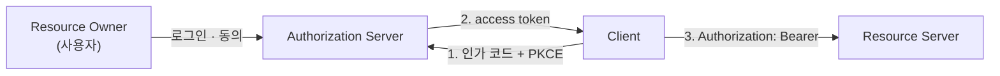
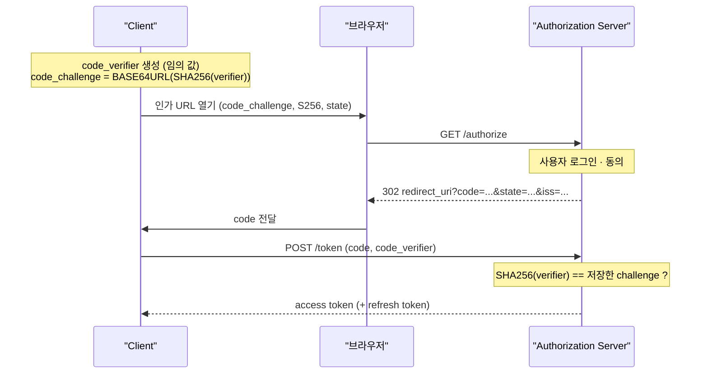
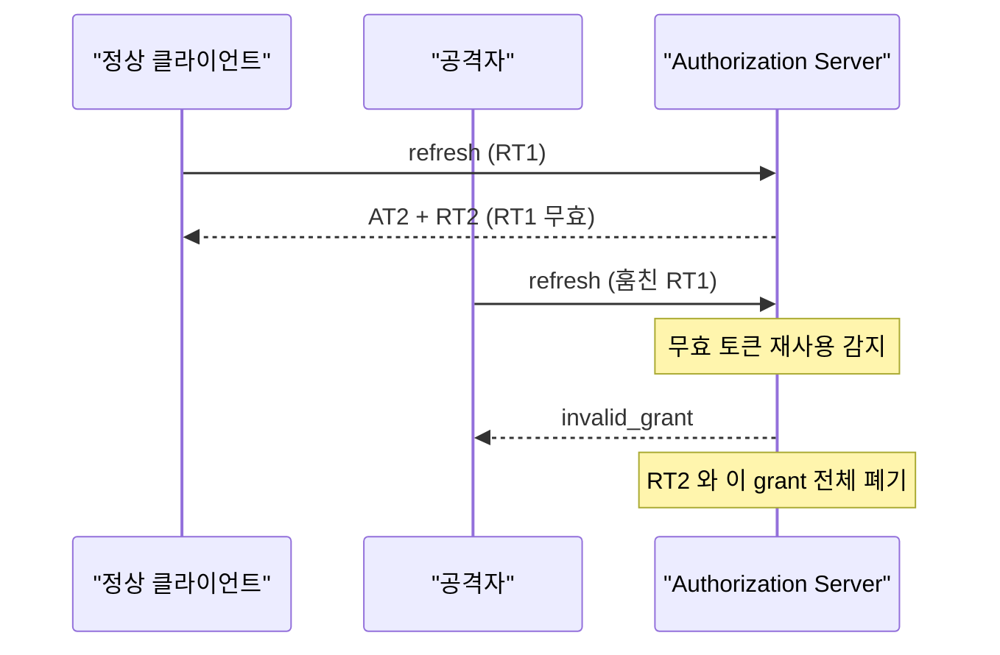

# OAuth 2.1 핵심 정리 — OAuth 2.0 에서 무엇이 바뀌었나

## OAuth 2.1 은 새 프로토콜이 아니다

OAuth 2.1 은 OAuth 2.0 이후 10년 넘게 따로 나온 보안 권고와 확장 문서들을 **한 권으로 합친 문서**입니다.
새 기능을 만든 것이 아니라, 그동안 "이렇게 쓰면 위험하다"고 밝혀진 방식을 빼고 "이렇게 써야 한다"는 권고를 필수로 올렸습니다.

합쳐진 문서는 다음과 같습니다.

| 문서       | 내용                               |
| -------- | -------------------------------- |
| [RFC 6749](https://datatracker.ietf.org/doc/html/rfc6749) | OAuth 2.0 본문                     |
| [RFC 6750](https://datatracker.ietf.org/doc/html/rfc6750) | Bearer 토큰 사용법                    |
| [RFC 7636](https://datatracker.ietf.org/doc/html/rfc7636) | PKCE                             |
| [RFC 8252](https://datatracker.ietf.org/doc/html/rfc8252) | 네이티브 앱용 OAuth                    |
| [RFC 9700](https://datatracker.ietf.org/doc/html/rfc9700) | OAuth 2.0 보안 모범 사례(Security BCP) |

> 2026년 11월 기준 최신판은 [`draft-ietf-oauth-v2-1-17`](https://datatracker.ietf.org/doc/draft-ietf-oauth-v2-1/) 이고 아직 RFC 가 아닌 Internet-Draft 입니다.
> 그래도 MCP 같은 최신 스펙은 이미 OAuth 2.1 을 기준으로 삼습니다.

---

## 네 가지 역할

| 역할                           | 하는 일                  | 예                     |
| ---------------------------- | --------------------- | --------------------- |
| Resource Owner               | 자원의 주인. 접근을 허락한다      | 사용자                   |
| Client                       | 사용자를 대신해 API 를 호출하는 앱 | 웹 앱, 모바일 앱, CLI       |
| Authorization Server (인가 서버) | 사용자를 인증하고 토큰을 발급      | Keycloak, Auth0, Okta |
| Resource Server (리소스 서버)     | 토큰을 검증하고 API 를 제공     | 우리가 만드는 API 서버        |



---

## OAuth 2.0 과 달라진 점

이 표 하나만 기억해도 OAuth 2.1 의 대부분을 이해한 것입니다.

| 변경 | 내용 | 이유 |
|---|---|---|
| **PKCE 필수** | 인가 코드 grant 는 PKCE 를 반드시 쓴다. `plain` 방식은 삭제, `S256` 만 남음 | 인가 코드 가로채기·주입 공격 방지 |
| **redirect URI 정확히 일치** | 등록한 값과 문자열로 정확히 비교. 패턴·와일드카드 매칭 금지 | 오픈 리다이렉트, 코드 유출 방지 |
| **Implicit grant 삭제** | 인가 응답으로 access token 을 주는 `response_type=token` 이 없어짐 | 토큰이 URL 조각(fragment)으로 노출됨 |
| **Password grant 삭제** | 앱이 사용자 ID·비밀번호를 받아 토큰을 받는 방식이 없어짐 | 앱이 비밀번호를 다루게 됨 |
| **쿼리 스트링 토큰 금지** | `?access_token=...` 으로 토큰을 보내지 않는다 | 로그·브라우저 기록·Referer 로 유출 |
| **공개 클라이언트의 refresh token 제한** | 발신자에 묶거나(sender-constrained) 한 번만 쓰게(회전) 해야 한다 | 탈취된 refresh token 재사용 방지 |
| **토큰 요청의 `redirect_uri` 삭제** | PKCE 가 코드 주입을 막으므로 필요 없어짐 | (2.0 클라이언트를 함께 받는 서버는 계속 검사) |

> OIDC 의 `response_type=id_token` 처럼 다른 스펙이 정의한 응답 유형은 영향을 받지 않습니다.

결과적으로 남은 grant 는 세 가지입니다.

| Grant                         | 언제 쓰나                                          |
| ----------------------------- | ---------------------------------------------- |
| **Authorization Code + PKCE** | 사용자가 브라우저로 로그인하는 모든 경우 (웹·SPA·모바일·CLI)         |
| **Client Credentials**        | 사용자 없이 서비스가 자기 이름으로 호출 (confidential client 만) |
| **Refresh Token**             | access token 이 만료되면 새로 받기                      |

Token Exchange(RFC 8693), Device Authorization(RFC 8628) 같은 것은 **확장 grant** 로 계속 쓸 수 있습니다.

---

## 인가 코드 + PKCE



**PKCE 가 막는 것**: 누군가 중간에 인가 코드를 가로채도, 처음 요청한 클라이언트만 아는 `code_verifier` 가 없으면 토큰으로 바꿀 수 없습니다.

규칙을 정리하면 다음과 같습니다.

| 항목 | 규칙 |
|---|---|
| `code_verifier` | 43~128자의 높은 엔트로피 문자열. 32바이트 난수를 base64url 로 인코딩하는 것을 권장 |
| `code_challenge_method` | `S256` 만. `plain` 금지 |
| PKCE 예외 | OIDC `nonce` 를 올바르게 처리하는 confidential client 만 예외. **공개 클라이언트는 예외 없음** |
| 코드 수명 | 짧게. 최대 10분 권장 |
| 코드 묶음 | client ID, code challenge, redirect URI 에 묶인다 |
| 코드 재사용 | 같은 코드로 두 번째 요청이 오면 거부하고, 그 코드로 발급한 토큰도 가능하면 폐기 |
| 응답의 `iss` | 인가 응답에 발급자(`iss`)를 넣는다 (RFC 9207, mix-up 공격 방지) |
| 잘못된 client ID / redirect URI | 그 URI 로 리다이렉트하지 않고 사용자에게 직접 오류를 보여 준다 |

---

## 클라이언트 종류

| 종류 | 뜻 | 예 |
|---|---|---|
| **Confidential** | 인가 서버에 자격증명(secret, 키)을 등록하고 안전하게 보관할 수 있다 | 서버에서 도는 웹 앱 |
| **Public** | 자격증명을 안전하게 보관할 수 없다 | SPA, 모바일 앱, 데스크톱 앱, CLI |

- 배포되는 앱(모바일·데스크톱) 안에 넣은 secret 은 **비밀이 아닙니다**. 인가 서버는 이런 앱에 secret 을 요구하지 말고 public client 로 다뤄야 합니다.
- confidential client 의 인증 방식으로는 `private_key_jwt`(개인키로 서명한 JWT, RFC 7523)나 mTLS 를 권장합니다. `client_secret_basic` 도 허용되지만 비밀값을 주고받는 방식이라 상대적으로 약합니다.
- Client Credentials grant 는 confidential client 만 쓸 수 있습니다.

---

## redirect URI

등록한 값과 **대소문자까지 한 글자씩** 비교합니다. 예외는 네이티브 앱의 루프백 주소에서 **포트만** 다를 수 있다는 것 하나입니다.

네이티브 앱(데스크톱·CLI·모바일)이 쓸 수 있는 리다이렉트 방식은 세 가지이고, 선호 순서는 다음과 같습니다.

| 순서 | 방식 | 예 | 특징 |
|---|---|---|---|
| 1 | Claimed https URI | `https://app.example.com/callback` | OS 가 "이 URL 은 이 앱 것"이라고 보증. 가장 안전 |
| 2 | 루프백 | `http://127.0.0.1:{아무 포트}/callback` | 앱이 로컬 포트를 잠깐 열어 받는다. 인가 서버는 **어떤 포트든 받아야 한다** |
| 3 | Private-use scheme | `com.example.app:/callback` | 다른 앱이 같은 scheme 을 등록해 가로챌 수 있어 최후의 수단 |

루프백에 대한 주의점:

- 루프백은 `http` 여도 괜찮습니다. 트래픽이 기기 밖으로 나가지 않기 때문입니다.
- `localhost` 대신 `127.0.0.1` 또는 `[::1]` 을 권장합니다. `localhost` 는 DNS·hosts 설정에 따라 다른 곳을 가리킬 수 있습니다.
- 포트는 요청하는 동안만 열고, 루프백 인터페이스에만 바인딩합니다.

또 네이티브 앱은 **앱 안의 웹뷰가 아니라 시스템 브라우저**로 로그인해야 합니다. 웹뷰는 앱이 사용자 비밀번호와 쿠키를 엿볼 수 있고, 사용자에게 "주소를 확인할 수 없는 화면에 비밀번호를 넣는" 습관을 들입니다.

---

## Refresh token

| 규칙 | 내용 |
|---|---|
| 클라이언트에 묶임 | 발급받은 클라이언트만 쓸 수 있다 |
| 리소스 서버로 보내지 않음 | refresh token 은 인가 서버하고만 주고받는다 |
| scope 확장 금지 | refresh 로 받은 토큰의 scope 는 처음 동의한 scope 를 넘을 수 없다 |
| 비활성 만료 | 일정 기간 쓰지 않으면 만료하는 것을 권장 |

**공개 클라이언트**는 다음 둘 중 하나를 반드시 적용해야 합니다.

1. **Sender-constrained**: DPoP(RFC 9449)나 mTLS 로 토큰을 클라이언트의 키에 묶는다. 토큰만 훔쳐서는 쓸 수 없다.
2. **회전(rotation)**: refresh 할 때마다 새 refresh token 을 주고 옛것은 무효로 한다. **무효가 된 토큰이 다시 들어오면** 탈취로 보고 현재 토큰과 그 인가(grant) 전체를 폐기한다.



회전은 "새 것을 준다"보다 **"옛것이 다시 오면 전부 끊는다"** 가 핵심입니다.

---

## 리소스 서버: Bearer 토큰 받기

### 토큰을 받는 방법

| 방법 | 규칙 |
|---|---|
| `Authorization: Bearer <token>` 헤더 | **기본**. 리소스 서버는 반드시 지원 |
| form body 의 `access_token` | 헤더를 쓸 수 없을 때만. POST, `application/x-www-form-urlencoded` 일 때만 |
| URL 쿼리 스트링 | **금지**. 리소스 서버는 쿼리의 토큰을 무시해야 한다 |

한 요청에 토큰을 두 가지 방법으로 함께 보내면 안 됩니다.

### 오류 응답

| 상황 | 상태 코드 | `WWW-Authenticate` |
|---|---|---|
| 토큰이 없음 | 401 | `Bearer` (error 코드를 넣지 않는다) |
| 요청 형식이 잘못됨 | 400 | `Bearer error="invalid_request"` |
| 토큰이 만료·폐기·위조됨 | 401 | `Bearer error="invalid_token"` |
| scope 부족 | 403 | `Bearer error="insufficient_scope", scope="필요한 scope"` |

```http
HTTP/1.1 403 Forbidden
WWW-Authenticate: Bearer error="insufficient_scope", scope="files:write"
```

### 토큰 엔드포인트 응답

- 성공 응답은 JSON 으로 `access_token`, `token_type`(필수), `expires_in`, `scope`, `refresh_token`(선택)을 담습니다.
- 응답 헤더에 `Cache-Control: no-store` 를 넣어 토큰이 캐시되지 않게 합니다.
- 오류는 기본 400 이고 `invalid_request`, `invalid_client`, `invalid_grant`, `unauthorized_client`, `unsupported_grant_type`, `invalid_scope` 중 하나를 씁니다.

---

## 보안 고려사항 요약

| 위협 | 대응 |
|---|---|
| 토큰 유출 | 항상 TLS. 토큰은 **짧은 수명 · 대상 하나(audience) · 최소 scope** 로 발급. 가능하면 DPoP·mTLS 로 발신자에 묶기 |
| 인가 코드 주입 | PKCE (`S256`) |
| CSRF | `state` 또는 PKCE. 인가 서버는 지원하는 challenge 방식을 메타데이터로 알린다 |
| Mix-up (인가 서버 여러 개) | 요청마다 기대하는 issuer 를 기록하고, 응답의 `iss` 와 비교 (RFC 9207) |
| 오픈 리다이렉트 | redirect URI 정확히 일치. 신뢰하지 않는 URI 로 자동 리다이렉트하지 않기 |
| 클릭재킹 | 인가 화면에 CSP `frame-ancestors` (또는 `X-Frame-Options`) |
| 자격증명 전달 리다이렉트 | 자격증명이 담긴 요청을 307 로 리다이렉트하지 않기 (303 사용) |
| 추측 공격 | 토큰·코드 등은 추측 확률 2^-128 이하 |
| 동의 피싱 | 클라이언트별로 scope 를 제한하고, 동의 내용을 명확히 보여 주고, 사용자가 동의를 검토·철회할 수 있게 |

---

## 브라우저 앱(SPA)은 어떻게 하나

OAuth 2.1 은 브라우저 앱 구조를 안전한 순서로 세 가지로 나눕니다.

| 순서 | 패턴 | 설명 |
|---|---|---|
| 1 | **BFF (Backend for Frontend)** | 백엔드가 confidential client 로 OAuth 를 처리하고 API 호출도 대신한다. 브라우저에는 토큰이 없다 |
| 2 | Token-mediating backend | 백엔드가 refresh token 을 쿠키 세션으로 관리하고, 브라우저는 access token 만 받아 직접 호출 |
| 3 | 브라우저 단독 클라이언트 | SPA 가 public client 로 직접 OAuth 를 처리 |

어느 패턴이든 인가 코드 grant 를 쓰고 implicit·password grant 는 쓰지 않습니다.
브라우저 단독이라면 refresh token 에 최대 수명이나 비활성 만료를 두고, 사용자 세션이 끝나면 함께 끝나게 합니다.

---

## 정리

OAuth 2.1 을 한 줄로 줄이면 **"인가 코드 + PKCE 로만 받고, 토큰은 짧게·좁게·헤더로만 쓴다"** 입니다.

- grant 는 인가 코드(+PKCE), client credentials, refresh token 세 가지
- redirect URI 는 정확히 일치, 네이티브 앱은 시스템 브라우저 + 루프백(`127.0.0.1`)
- 공개 클라이언트의 refresh token 은 회전하거나 발신자에 묶는다
- 리소스 서버는 헤더의 Bearer 토큰만 받고, 401·403 을 구분해 응답한다

## 참고

- [The OAuth 2.1 Authorization Framework (draft-ietf-oauth-v2-1)](https://datatracker.ietf.org/doc/draft-ietf-oauth-v2-1/)
- [RFC 7636 — PKCE](https://datatracker.ietf.org/doc/html/rfc7636)
- [RFC 8252 — OAuth 2.0 for Native Apps](https://datatracker.ietf.org/doc/html/rfc8252)
- [RFC 9700 — OAuth 2.0 Security Best Current Practice](https://datatracker.ietf.org/doc/html/rfc9700)
- [RFC 9207 — Authorization Server Issuer Identification](https://datatracker.ietf.org/doc/html/rfc9207)
