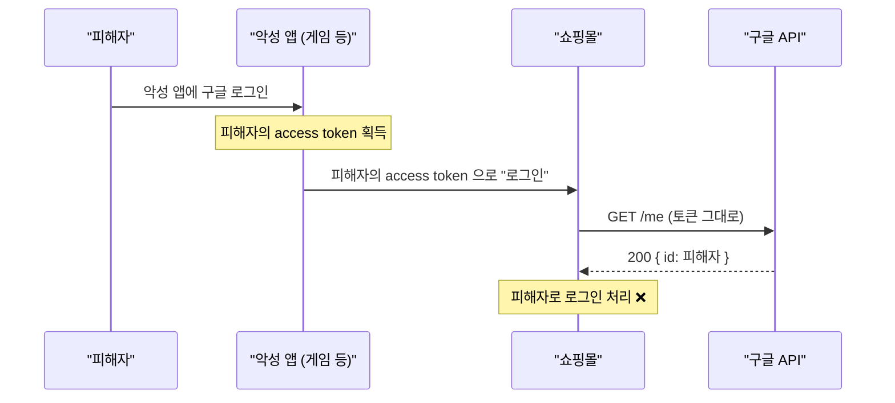
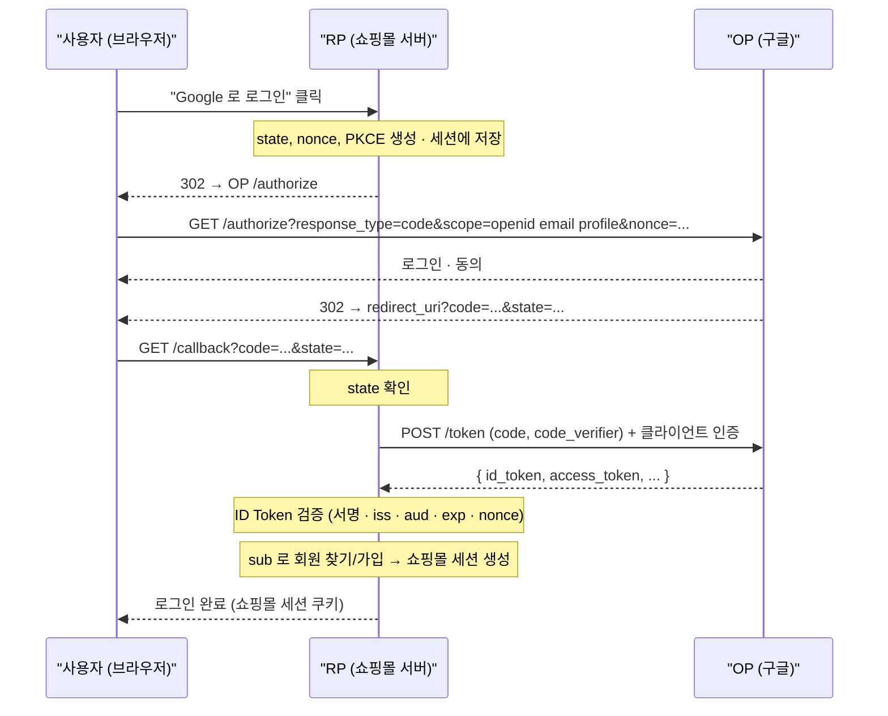

# OpenID Connect(OIDC) — OAuth 2.0 위에 얹은 로그인

## "Google 로 로그인"은 무엇인가

쇼핑몰의 "Google 로 로그인" 버튼을 누르면 구글 로그인 화면이 뜨고, 로그인하면 쇼핑몰로 돌아와 회원으로 로그인됩니다.
겉으로 보면 [OAuth 2.0](https://github.com/eastshine-high/til/blob/main/oauth/oauth-2.0.md) 의 인가 코드 흐름과 똑같습니다. 실제로도 같은 흐름을 씁니다.

차이는 **쇼핑몰이 원하는 것**입니다.

| | 순수 OAuth | Google 로 로그인 |
|---|---|---|
| 앱이 원하는 것 | 구글 API 호출 권한 (예: 드라이브 사진 읽기) | **"이 사람이 누구인가"** |
| 핵심 결과물 | Access Token | **ID Token** |
| 토큰을 읽는 쪽 | 구글 API (Resource Server) | 쇼핑몰 자신 |
| 받은 뒤 | 토큰으로 계속 API 를 호출 | 쇼핑몰 세션을 만들고 끝 |

OAuth 2.0 은 권한 위임 프레임워크라서 "누가 로그인했는가"를 표준으로 알려 주지 않습니다.
**OpenID Connect(OIDC)** 는 OAuth 2.0 위에 이 빈자리를 채운 **인증(authentication) 계층**입니다. "Google 로 로그인"은 OIDC 입니다.

> OIDC 는 IETF 가 아니라 **OpenID Foundation** 이 만든 표준입니다. 핵심 문서는 [OpenID Connect Core 1.0](https://openid.net/specs/openid-connect-core-1_0.html) 입니다.

---

## OAuth 만으로 로그인하면 생기는 문제

OIDC 가 나오기 전에는 이렇게 "로그인"을 만드는 서비스가 있었습니다.

1. OAuth 로 access token 을 받는다.
2. 그 토큰으로 프로필 API(`/me`)를 부른다.
3. 응답이 오면 "로그인 성공", 응답의 사용자 ID 로 회원을 찾는다.

문제는 access token 에 **"누구를 위해 발급했다"는 정보가 없다**는 것입니다.



구글 API 입장에서는 정상 토큰이니 응답합니다. 쇼핑몰은 이 토큰이 **자기에게 발급된 것인지 확인할 방법이 없습니다.** 이를 **토큰 치환(token substitution)** 이라고 합니다.

OIDC 의 ID Token 은 `aud`(대상) 에 **받을 앱의 client_id** 를 넣고 서명합니다. 다른 앱용 ID Token 을 가져오면 `aud` 가 맞지 않아 거부됩니다.

---

## 용어 — OAuth 역할과 대응

| OIDC 용어 | OAuth 역할 | 예 |
|---|---|---|
| **End-User** | Resource Owner | 로그인하는 사람 |
| **Relying Party (RP)** | Client | 쇼핑몰 (로그인 결과를 "믿고 의존하는" 쪽) |
| **OpenID Provider (OP)** | Authorization Server | 구글, Keycloak |
| UserInfo Endpoint | Resource Server | OP 가 제공하는 사용자 정보 API |

---

## OIDC 가 OAuth 2.0 에 더한 것

| 추가된 것 | 설명 |
|---|---|
| `scope=openid` | 이 값이 있으면 OIDC 요청. 없으면 그냥 OAuth |
| **ID Token** | 로그인 결과를 담은 서명된 JWT |
| 표준 클레임 | `sub`, `name`, `email` 등 사용자 정보의 이름과 뜻을 표준화 |
| **UserInfo Endpoint** | access token 으로 사용자 정보를 받는 표준 API |
| `nonce` | ID Token 재사용(replay) 방지 |
| **Discovery** | `/.well-known/openid-configuration` 으로 OP 정보 공개 |
| 로그아웃 | RP-Initiated, Back-Channel, Front-Channel Logout (별도 문서) |

---

## 흐름 — Authorization Code Flow

OAuth 의 인가 코드 grant 와 같고, 굵게 표시한 부분만 다릅니다.



**인가 요청**

```http
GET /authorize?response_type=code
  &client_id=shop-client-id
  &redirect_uri=https%3A%2F%2Fshop.example.com%2Fcallback
  &scope=openid%20email%20profile
  &state=af0ifjsldkj
  &nonce=n-0S6_WzA2Mj
  &code_challenge=E9Melhoa2OwvFrEMTJguCHaoeK1t8URWbuGJSstw-cM
  &code_challenge_method=S256 HTTP/1.1
Host: accounts.example.com
```

**토큰 응답**

```json
{
  "access_token": "SlAV32hkKG",
  "token_type": "Bearer",
  "expires_in": 3600,
  "id_token": "eyJhbGciOiJSUzI1NiIsImtpZCI6IjFlOWdkazcifQ.eyJpc3Mi..."
}
```

로그인 뒤에는 **RP 자체 세션**으로 로그인 상태를 유지합니다. ID Token 을 매 요청마다 들고 다니는 것이 아닙니다.

> OIDC Core 에는 Implicit Flow(`response_type=id_token token`)와 Hybrid Flow(`code id_token` 등)도 있습니다.
> 하지만 OAuth 2.1 과 같은 이유로 지금은 **Authorization Code Flow + PKCE** 를 쓰는 것이 기본입니다.

---

## ID Token

ID Token 은 OP 가 서명한 **JWT** 입니다. "이 사용자가, 이 시각에, 이 앱을 위해 로그인했다"는 증명서입니다.

```json
{
  "iss": "https://accounts.example.com",
  "sub": "110169484474386276334",
  "aud": "shop-client-id",
  "exp": 1764003600,
  "iat": 1764000000,
  "auth_time": 1763999990,
  "nonce": "n-0S6_WzA2Mj",
  "email": "jane@example.com",
  "email_verified": true,
  "name": "Jane Doe"
}
```

| 클레임 | 뜻 | 필수 |
|---|---|---|
| `iss` | 발급한 OP | 필수 |
| `sub` | OP 안에서 이 사용자의 **고유하고 변하지 않는** ID | 필수 |
| `aud` | 이 토큰을 받을 RP 의 client_id | 필수 |
| `exp` / `iat` | 만료 / 발급 시각 | 필수 |
| `auth_time` | 사용자가 실제로 인증한 시각 | `max_age` 를 요청했으면 필수 |
| `nonce` | 인가 요청에 보낸 값 그대로 | 요청에 넣었으면 필수 |
| `acr` / `amr` | 인증 수준 / 인증 방법 (예: `pwd`, `mfa`) | 선택 |
| `azp` | 토큰을 받아 간 client (aud 가 여럿일 때) | 경우에 따라 |
| `at_hash` | 함께 받은 access token 의 해시 | 흐름에 따라 |

### 사용자를 식별하는 키는 `iss` + `sub`

- `sub` 는 **OP 안에서만** 고유합니다. 구글의 `sub` 와 다른 OP 의 `sub` 가 우연히 같을 수 있으므로 회원 연결 키는 **`iss` + `sub`** 조합으로 둡니다.
- **email 을 키로 쓰면 안 됩니다.** 이메일은 바뀔 수 있고, OP 에 따라 검증되지 않은 이메일(`email_verified: false`)일 수도 있습니다. 검증 안 된 이메일로 기존 회원에 자동 연결하면 계정 탈취로 이어집니다.

### ID Token 과 Access Token 은 쓰임이 다르다

| | ID Token | Access Token |
|---|---|---|
| 받는 쪽 | **RP 자신** | Resource Server (API) |
| 담은 것 | 로그인 사실, 사용자 정보 | API 호출 권한 |
| `aud` | RP 의 client_id | API 식별자 (형식은 OP 마다 다름) |
| API 에 보내도 되나 | **보내지 않는다** | 보낸다 |

ID Token 을 API 호출에 `Bearer` 로 쓰는 것은 흔한 실수입니다. ID Token 의 `aud` 는 RP 이지 API 가 아니기 때문입니다.

---

## ID Token 검증

RP 가 반드시 해야 하는 검증입니다(OIDC Core 3.1.3.7 요약).

1. **서명**: OP 의 공개키(JWKS)로 서명을 검증합니다. `alg` 는 등록·예상한 값만 허용하고 `none` 은 거부합니다.
2. **`iss`**: Discovery 로 알게 된 OP 의 issuer 와 정확히 같은지.
3. **`aud`**: 내 client_id 가 들어 있는지. 다른 값이 함께 있으면 신뢰하는 값인지 확인합니다.
4. **`azp`**: `aud` 가 여러 개라면 `azp` 가 내 client_id 인지.
5. **`exp`**: 지나지 않았는지 (작은 시계 오차만 허용).
6. **`iat`**: 너무 오래전에 발급된 토큰이 아닌지.
7. **`nonce`**: 인가 요청 때 세션에 저장한 값과 같은지.
8. **`auth_time`**: `max_age` 를 요청했다면 그 시간 안에 인증했는지.
9. **`acr`**: 특정 인증 수준을 요청했다면 그 수준인지.

> 토큰 엔드포인트에서 TLS 로 직접 받은 ID Token 이라면 서명 대신 TLS 서버 인증을 근거로 삼을 수 있다고 스펙은 허용합니다.
> 그래도 라이브러리로 서명까지 검증하는 것이 안전하고 일반적입니다. **JWT 검증은 직접 구현하지 말고 검증된 라이브러리**를 씁니다.

### state 와 nonce 는 무엇이 다른가

| | `state` | `nonce` |
|---|---|---|
| 정의한 곳 | OAuth 2.0 | OIDC |
| 돌아오는 곳 | 인가 응답의 URL 파라미터 | **ID Token 안** (서명됨) |
| 막는 것 | CSRF (남의 인가 응답을 내 세션에 주입) | ID Token 재사용 (예전 토큰을 다시 들이밀기) |

둘 다 RP 가 만든 임의 값을 세션에 저장했다가 돌아온 값과 비교한다는 점은 같습니다. PKCE 를 쓰면 CSRF 방어 효과도 있지만, OIDC 에서는 `nonce` 를 함께 쓰는 것이 일반적입니다.

---

## Scope 와 표준 클레임

`openid` 외에 아래 scope 로 받을 사용자 정보를 고릅니다.

| scope | 받는 클레임 |
|---|---|
| `openid` | (필수) `sub` |
| `profile` | `name`, `family_name`, `given_name`, `nickname`, `picture`, `locale` 등 |
| `email` | `email`, `email_verified` |
| `address` | `address` |
| `phone` | `phone_number`, `phone_number_verified` |
| `offline_access` | refresh token 요청 (사용자가 없을 때도 접근) |

이 클레임들은 ID Token 에 들어 있을 수도 있고, UserInfo 엔드포인트에서만 줄 수도 있습니다. OP 마다 다릅니다.

---

## UserInfo Endpoint

access token 으로 사용자 정보를 받는 표준 API 입니다.

```http
GET /userinfo HTTP/1.1
Host: accounts.example.com
Authorization: Bearer SlAV32hkKG
```

```json
{
  "sub": "110169484474386276334",
  "name": "Jane Doe",
  "email": "jane@example.com",
  "email_verified": true,
  "picture": "https://example.com/jane.jpg"
}
```

- 응답의 `sub` 가 **ID Token 의 `sub` 와 같은지** 반드시 확인합니다. 다르면 쓰지 않습니다.
- 로그인 판단은 ID Token 으로 합니다. UserInfo 는 추가 정보를 얻는 곳입니다.

---

## Discovery 와 JWKS

OP 는 자기 정보를 [OpenID Connect Discovery](https://openid.net/specs/openid-connect-discovery-1_0.html) 문서로 공개합니다.

```
{issuer}/.well-known/openid-configuration
```

```json
{
  "issuer": "https://accounts.example.com",
  "authorization_endpoint": "https://accounts.example.com/authorize",
  "token_endpoint": "https://accounts.example.com/token",
  "userinfo_endpoint": "https://accounts.example.com/userinfo",
  "jwks_uri": "https://accounts.example.com/jwks",
  "end_session_endpoint": "https://accounts.example.com/logout",
  "response_types_supported": ["code"],
  "scopes_supported": ["openid", "email", "profile"],
  "id_token_signing_alg_values_supported": ["RS256"],
  "code_challenge_methods_supported": ["S256"]
}
```

- RP 는 issuer 하나만 설정하면 나머지 엔드포인트를 여기서 찾습니다.
- 문서의 `issuer` 는 요청한 issuer 와 **정확히 같아야** 합니다.
- `jwks_uri` 에서 받은 공개키로 ID Token 서명을 검증합니다. 키는 캐시하되, 모르는 `kid` 가 오면 다시 받습니다(키 교체 대응).

OAuth 에도 비슷한 [RFC 8414](https://datatracker.ietf.org/doc/html/rfc8414)(`/.well-known/oauth-authorization-server`)가 있고, 내용은 거의 같습니다. OIDC Discovery 가 먼저 나왔고 RFC 8414 가 이를 OAuth 일반으로 넓힌 것입니다.

---

## 로그인 동작 조절 파라미터

| 파라미터 | 값 | 효과 |
|---|---|---|
| `prompt` | `none` | 화면을 띄우지 않는다. 이미 로그인돼 있으면 바로 응답, 아니면 `login_required` 오류 ("조용한 로그인" 확인용) |
| | `login` | 이미 로그인돼 있어도 다시 인증하게 한다 |
| | `consent` | 동의 화면을 다시 띄운다 |
| | `select_account` | 계정 선택 화면 |
| `max_age` | 초 | 마지막 인증이 이 시간보다 오래됐으면 다시 인증 (`auth_time` 으로 확인) |
| `login_hint` | 이메일 등 | 로그인 화면에 ID 를 미리 채움 |
| `acr_values` | 인증 수준 | 원하는 인증 수준 요청 (예: MFA) |

---

## 로그아웃

로그인이 RP 세션과 OP 세션 **두 곳**에 생기므로, 로그아웃도 두 방향을 생각해야 합니다.

| 방식 | 문서 | 동작 |
|---|---|---|
| **RP-Initiated Logout** | OIDC RP-Initiated Logout 1.0 | RP 가 사용자를 OP 의 `end_session_endpoint` 로 보내 OP 세션도 끝낸다 (`id_token_hint`, `post_logout_redirect_uri`) |
| **Back-Channel Logout** | OIDC Back-Channel Logout 1.0 | OP 세션이 끝나면 OP 가 각 RP 서버로 직접 **Logout Token**(JWT)을 보낸다. 브라우저와 무관해 가장 확실 |
| Front-Channel Logout | OIDC Front-Channel Logout 1.0 | OP 가 브라우저에서 각 RP 의 로그아웃 URL 을 iframe 으로 부른다. 서드파티 쿠키 차단에 취약 |

RP 세션만 지우면 OP 세션은 살아 있어서, 다시 "Google 로 로그인"을 누르면 비밀번호 없이 바로 로그인됩니다. 공용 PC 같은 환경이라면 RP-Initiated Logout 까지 하는 것이 좋습니다.

---

## SSO 와의 관계

같은 OP 를 쓰는 RP 가 여러 개면, OP 에 한 번 로그인한 사용자는 다른 RP 에서 로그인 화면 없이 바로 들어갑니다. OP 세션이 살아 있기 때문입니다. 이것이 OIDC 기반 **SSO(Single Sign-On)** 입니다.
회사 안 여러 서비스를 Keycloak 같은 OP 하나에 붙이는 것이 대표적인 예입니다.

---

## 정리

- **OIDC = OAuth 2.0 + 인증.** `scope=openid` 로 시작하고, 결과물은 **ID Token**.
- "Google 로 로그인"은 OIDC. 쇼핑몰은 RP, 구글은 OP.
- ID Token 은 **RP 가 읽는 로그인 증명서**, Access Token 은 **API 가 읽는 권한 증명서**. ID Token 을 API 에 보내지 않는다.
- ID Token 검증: 서명 · `iss` · **`aud` = 내 client_id** · `exp` · `nonce`.
- 회원 키는 `iss` + `sub`. email 은 키가 아니다.
- Discovery(`/.well-known/openid-configuration`)로 엔드포인트와 공개키를 찾는다.
- 로그아웃은 RP 세션과 OP 세션을 모두 생각한다.

## 참고

- [OpenID Connect Core 1.0](https://openid.net/specs/openid-connect-core-1_0.html)
- [OpenID Connect Discovery 1.0](https://openid.net/specs/openid-connect-discovery-1_0.html)
- [OpenID Connect RP-Initiated Logout 1.0](https://openid.net/specs/openid-connect-rpinitiated-1_0.html)
- [OpenID Connect Back-Channel Logout 1.0](https://openid.net/specs/openid-connect-backchannel-1_0.html)
- [How OpenID Connect Works — OpenID Foundation](https://openid.net/developers/how-connect-works/)
